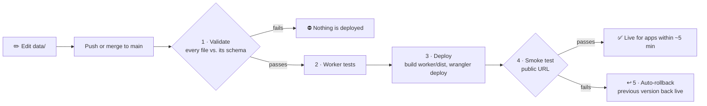

# Maintaining Cancer Open Data

How the API is served, how a change goes live, and how to change the data. For using the API, see the [README](README.md) and the [API guide](API-GUIDE.md).

## Contents
- [How it's served](#how-its-served)
- [The docs](#the-docs)
- [How a change goes live](#how-a-change-goes-live)
- [Versioning and rollback](#versioning-and-rollback)
- [Changing the data](#changing-the-data)
- [Deploy setup](#deploy-setup)
- [Deploy emails](#deploy-emails)
- [Working on the Worker](#working-on-the-worker)
- [Files](#files)

## How it's served

The data files are **Workers Static Assets**: Cloudflare's edge serves them directly, without running any code.
- Requests for static files are free and don't count toward the Workers daily request limit.
- Files come from the Cloudflare location nearest each user.
- Headers (CORS, `Cache-Control: public, max-age=300`, `nosniff`) come from `worker/dist/_headers`. ETag and `304` work automatically.

The small Worker script (`worker/src/index.js`) runs only for `/` (the dataset list) and for paths with no file (`404`).

## The docs

- **`/openapi.json` is generated at build time** (`scripts/build-openapi.mjs`) from the real schema files. Change a schema, and the docs change on the next deploy, so they can't drift from the data. Dataset descriptions live in `DESCRIPTIONS` in that file; a new dataset without one gets a generic line.
- **`/docs/` is Swagger UI, hosted here** (copied from the `swagger-ui-dist` package at build), with no CDN. The page files are in `docs/`.
- `/docs/` sends a strict `Content-Security-Policy`: scripts only from this site, no framing, nothing sent elsewhere. Swagger's online validator is off, so the spec isn't sent to swagger.io.
- Tests check that the spec is valid OpenAPI 3.1 and that each schema is embedded exactly as written. The smoke test checks that both routes respond after each deploy.

## How a change goes live



The smoke test fetches every file from the public URL and checks status `200`, the same bytes as the repo, the CORS header and the JSON content type.

- **Auto-rollback:** if a deploy goes live but fails the smoke test, CI runs `wrangler rollback`, so the last good version serves again within seconds. The run still ends red with a "Rolled back" error, so someone fixes the cause.
- **Fire drill:** to prove rollback works, run the workflow by hand (Actions → Validate and deploy data → Run workflow) with **rollback_drill** ticked. It deploys, fails the smoke test on purpose and rolls back. The data stays the same, so users notice nothing.
- **Pull requests** run steps 1 and 2 only. Use them to review changes before they go live.
- **Each deploy switches all files at once.** There's no moment where some files are new and some old.
- **Removing a file** from `data/` removes it from the API on the next deploy.
- **Docs files** (`*.md` in the root) aren't watched by the workflow, so changing them doesn't deploy.

## Versioning and rollback

1. **Git:** every change is a commit with who, when, why and the exact diff. `git revert <commit>` and push redeploys the old data.
2. **Worker versions:** Cloudflare keeps every deploy. For an instant rollback without waiting for CI:
   ```bash
   cd worker
   npx wrangler deployments list
   npx wrangler rollback
   ```
   Then fix Git too, or the next push brings the bad data back.

`GET /` shows the deployed commit in `version`. Every version is listed in [CHANGELOG.md](CHANGELOG.md).

## Changing the data

Check locally before you push:

```bash
npm install
npm run validate
```

**Adding an image:** put it in `images/<Folder>/` (rules in [images/README.md](images/README.md)), set the field to `/images/<Folder>/<file>`, run `npm run validate`, and push. The check fails if the file is missing, badly named, the wrong type, or over 5 MB.

**Adding a new dataset:**
1. Make a folder in `data/`, for example `data/Hospice/`. Use letters, digits, `-` or `_`.
2. Add the schema `HospiceData.schema.json` (JSON Schema draft 2020-12) and the data file `HospiceData.json`.
3. Start the data file with `"$schema": "./HospiceData.schema.json"`. The check fails if this doesn't point to the schema next to it.
4. Run `npm run validate`, then push. The new dataset appears at `/` by itself, with no code change.

**Before changing a schema:** apps rely on it. Tell the people who build on the API first, and add the change to [CHANGELOG.md](CHANGELOG.md).

## Deploy setup

**In Cloudflare:** My Profile → **API Tokens** → **Create Token** → template **Edit Cloudflare Workers** → limit it to your account → **Create Token**. Copy the token (shown once).

**In GitHub** (repo → Settings → Secrets and variables → Actions):

| Kind | Name | Value |
|---|---|---|
| Secret | `CLOUDFLARE_API_TOKEN` | The token from above |
| Variable | `CLOUDFLARE_ACCOUNT_ID` | `bc15d41433f443043305b72bec679e32` |
| Variable | `PUBLIC_URL` | `https://cancer-open-data.capillanesjohnfritz.workers.dev` (the smoke test checks this) |

If a setting is missing, the deploy job stops at once and names it. GitHub never passes secrets to pull requests from forks, and deploy runs only on `main`.

## Deploy emails

After each successful deploy to `main`, `.github/workflows/notify-deploy.yml` emails the people who build on the API: the new version, the commits since the last deploy, which data files changed, and links to the changelog and the compare view. The rollback drill and pull requests send nothing.

**Turn it on** (repo → Settings → Secrets and variables → Actions → **Secrets**):

| Secret | Value |
|---|---|
| `MAIL_USERNAME` | The Gmail address that sends the email |
| `MAIL_PASSWORD` | A Gmail **App Password** for that account: Google Account → Security → 2-Step Verification (must be on) → App passwords → create one named "Cancer Open Data". Never the normal password |
| `MAIL_TO` | Who gets it, comma-separated, e.g. `you@example.com, teammate@example.com` |

- The addresses are **secrets**, not variables or code, because the repo is public.
- Without all three, the job skips and leaves a notice in the run.
- **Test it:** Actions → **Email deploy update** → **Run workflow**. It emails about the latest deploy.
- **Stop it:** delete `MAIL_PASSWORD` (or revoke the App Password in the Google Account).
- The email step uses `dawidd6/action-send-mail` pinned to an exact commit, so the code that receives the password can't change without a pull request here.

## Working on the Worker

```bash
node scripts/build-site.mjs   # from the repo root: data/ -> worker/dist/
cd worker
npm install
npm test                      # the Worker tests, with Wrangler's local runner (real asset routing)
npx wrangler login            # once per PC, only for a manual deploy
npx wrangler deploy           # manual deploy (CI does this on every push to main)
```

## Files

| Path | What it does |
|---|---|
| `data/` | The datasets and schemas |
| `scripts/validate.mjs` | Checks each data file against its schema (Ajv, draft 2020-12) |
| `scripts/build-site.mjs` | Builds `worker/dist/`: the data files, images, `index.json` and `_headers` |
| `scripts/images.mjs` | Image rules shared by validate and build (types, names, sizes) |
| `scripts/build-openapi.mjs` | Generates `/openapi.json` from the schemas |
| `scripts/smoke-test.sh` | Checks the public URL after each deploy |
| `docs/` | The `/docs/` page (Swagger UI setup) |
| `images/` | Images served at `/images/...` (rules in `images/README.md`) |
| `worker/` | Worker config, the small script for `/`, and its tests |
| `.github/workflows/deploy-data.yml` | The pipeline |
| `.github/workflows/notify-deploy.yml` | Emails an update after each successful deploy (see [Deploy emails](#deploy-emails)) |
| `.github/ISSUE_TEMPLATE/` | Issue forms: wrong data, new resource, API problem, privacy or removal request |
| `README.md` · `API-GUIDE.md` · `MAINTAINING.md` | Quick start · full API guide · this file |
| `MILESTONES.md` · `CHANGELOG.md` | Where the project is going · what changed in each version |
